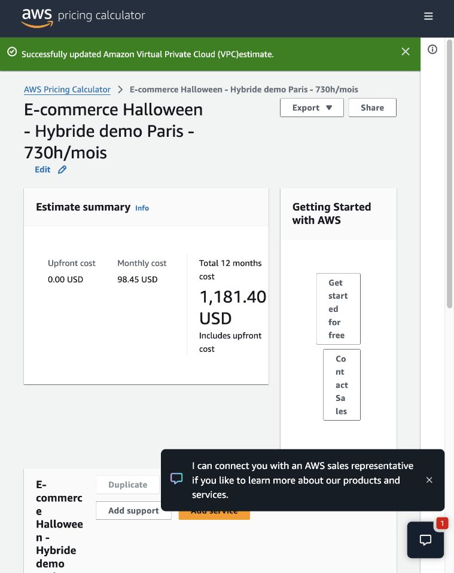

# Estimation AWS de l’architecture hybride

Estimation créée dans AWS Pricing Calculator le 29 octobre 2026, puis sauvegardée et ouverte depuis son lien public :

[Ouvrir l’estimation hybride](https://calculator.aws/#/estimate?id=5db38ebdd54994638d207d9aed0e66f3cc6551fa)

**98,45 USD/mois ; 1 181,40 USD sur douze mois ; aucun paiement initial.** Montants hors taxes, hors crédits promotionnels et sans engagement. Le lien public expire après un an selon le calculateur. Il ne contient ni identifiants AWS ni adresses email de l’équipe.

## Configuration et hypothèses

Le scénario correspond au mode réduit du dépôt, `high_availability=false`, avec les ressources permanentes actives 730 heures par mois. Les valeurs de trafic sont des hypothèses de démonstration, pas des mesures de production : 1 000 commandes, 100 utilisateurs actifs Cognito, 100 000 requêtes HTTPS et 10 Go distribués en Europe par mois. Le scénario n’inclut pas de seconde EC2 lors des pointes d’Auto Scaling.

| Poste | Configuration / hypothèse | USD/mois affichés |
| --- | --- | ---: |
| EC2 + EBS | 1 t3.micro Linux à la demande, 12 Go gp3, Paris | 9,72 |
| RDS PostgreSQL | 1 db.t4g.micro Single-AZ, 20 Go gp2, sans Proxy ni Database Insights payant ni Extended Support | 15,80 |
| VPC | 1 NAT zonal, 10 Go traités, 1 IPv4 publique | 40,65 |
| ALB | 1 ALB interne, environ 10 Go/mois traités | 19,40 |
| Lambda | 4 010 appels/mois à 256 Mo x86, durée moyenne globale supposée 1,1 s, sans provisioned concurrency | 0,02 |
| CloudFront | 10 Go sortants, 0,1 Go vers origine, 100 000 requêtes HTTPS en Europe | 0,97 |
| S3 | 5 Go cumulés frontend/artefacts/audit, versions incluses ; 10 000 PUT/LIST, 50 000 GET | 0,19 |
| SNS | 3 000 publications, 4 000 livraisons SQS, 30 notifications email d’alerte | 0,00 |
| SQS | 410 000 requêtes standard, incluant une provision pour le polling long des trois files ; DLQ sans échec supposé | 0,16 |
| SES | 2 000 emails transactionnels, sans IP dédiée ni pièces jointes | 0,20 |
| Cognito | 100 MAU, Essentials par défaut pour un nouveau pool | 0,00 |
| WAF CloudFront | 1 ACL, 1 règle de débit, 1 groupe AWS Common, 100 000 requêtes ; gestion us-east-1 | 7,06 |
| Secrets Manager | 2 secrets SQL conservés 30 jours, 10 000 appels API | 0,85 |
| CloudWatch | 2 métriques personnalisées, 13 alarmes standard, 90 000 appels API, 1 Go de logs ingérés | 3,40 |
| CloudTrail | 100 000 événements de gestion, première copie d’un trail régional ; stockage compté dans S3 | 0,00 |
| KMS | 0 clé gérée par le client, 10 000 appels symétriques supposés | 0,03 |

Les montants sont ceux affichés par le calculateur et arrondis par poste. Les offres gratuites ne sont pas soustraites manuellement ; Lambda est explicitement configuré sans Free Tier. Cognito et la première copie CloudTrail conservent les franchises intégrées par le calculateur. Le coût facturé peut donc être inférieur avec les quotas gratuits disponibles et les crédits du compte.

## Limites à connaître

- Le formulaire VPC impose aussi les champs « Regional NAT Gateway », alors que le Terraform crée uniquement un NAT zonal. Ils sont renseignés à 1 gateway / 1 AZ / 0 Go pour permettre l’enregistrement ; le calculateur affiche **0 USD** pour ce sous-poste. Ce champ n’est pas une ressource supplémentaire de l’architecture. Le coût réseau de 40,65 USD correspond au NAT zonal (36,50 USD), à ses 10 Go traités (0,50 USD) et à l’IPv4 (3,65 USD). Cette particularité est signalée dans la description de la ligne VPC partagée.
- CloudWatch calcule le stockage des logs sur un mois, alors que le Terraform retient 14 jours. La petite surestimation correspondante est conservée et signalée dans la description.
- Les sauvegardes RDS sont supposées rester dans le quota associé à une base active ; aucun snapshot conservé après suppression ni excédent de sauvegarde n’est ajouté.
- Les transferts inter-AZ ne sont pas chiffrés faute de volumes mesurés. Ils peuvent concerner SQL et le NAT unique. Les éventuels crédits CPU des instances burstables, les déploiements supplémentaires et les reprises après incident ne sont pas chiffrés.
- IAM, Auto Scaling, le VPC de base, l’Internet Gateway, l’endpoint S3 Gateway, Shield Standard et les fonctions standard SSM utilisées n’ajoutent pas de ligne payante propre dans ce scénario. Le budget Terraform est une alerte et n’est pas un plafond de coût ; aucun Budget Action ni support payant n’est ajouté.
- L’estimation n’atteste pas de ressources actuellement déployées et ne prédit pas la facture d’un compte particulier.

Source du choix Cognito Essentials : [plan par défaut des nouveaux pools, documentation AWS](https://docs.aws.amazon.com/cognito/latest/developerguide/cognito-sign-in-feature-plans.html).
