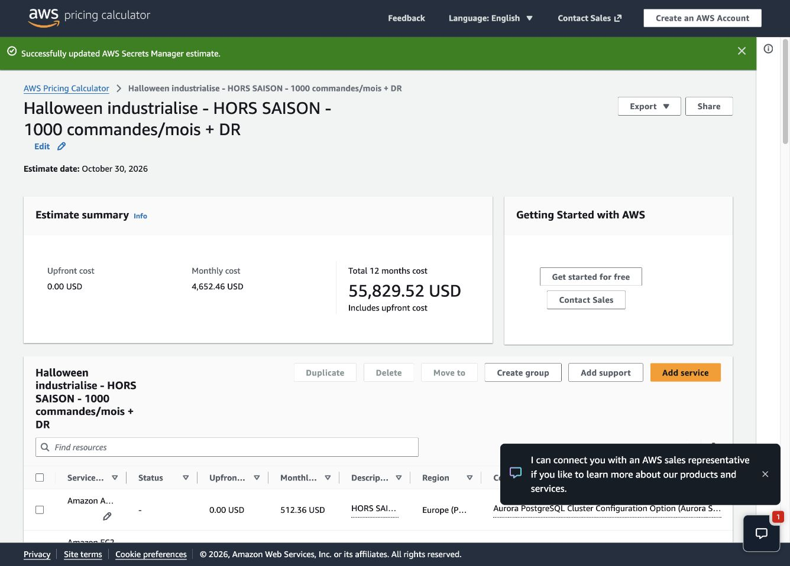

# Estimation saisonnière de la cible industrialisée

Calculs réalisés dans AWS Pricing Calculator les 29 et 30 octobre 2026. Le scénario conserve la cible décrite dans `industrialisation.md` : production Paris et warm standby en Irlande. Il ne suppose plus un trafic de pointe toute l’année.

## Résultats

| Période | Hypothèse de charge | Coût mensuel affiché |
| --- | --- | ---: |
| Hors saison, 11 mois | 1 000 commandes, 100 utilisateurs actifs, 100 000 requêtes HTTPS, 10 Go CDN | **4 652,46 USD** |
| Pointe, 1 mois autour d’Halloween | 100 000 commandes, 10 000 utilisateurs actifs, 10 millions de requêtes HTTPS, 500 Go CDN | **5 039,38 USD** |

**Budget annuel saisonnier : 11 × 4 652,46 + 5 039,38 = 56 216,44 USD**, soit environ **4 684,70 USD/mois en moyenne**. Montants hors taxes, avant crédits promotionnels. Ce sont des hypothèses, pas des prévisions de ventes validées.

Les deux écrans du calculateur extrapolent chacun leur propre mois sur douze mois. Leurs colonnes « Total 12 months » ne représentent donc pas ce calendrier saisonnier : utiliser le calcul pondéré ci-dessus. Le maintien des sauvegardes et archives du pic peut aussi décaler une partie du coût sur le mois suivant.

- [Estimation enregistrée du mois de pointe](https://calculator.aws/#/estimate?id=3d59fd6dae4e7c04fbe471766094c6224f968caf).
- Scénario hors saison : configuré et vérifié dans l’onglet du calculateur, mais son lien public reste en attente de confirmation utilisateur. La revue automatique a refusé sa publication publique sur AWS.
- `estimation-industrialisation-details.json` conserve les 43 lignes visibles de chaque scénario, leurs descriptions et leurs configurations. Ce fichier est une capture structurée du tableau, pas un export natif AWS ; la tentative d’export natif a bloqué.

## Capacité conservée et capacité saisonnière

À Paris : deux EC2 API c7g.large, deux publishers t4g.small, un ALB privé, deux NAT, trois endpoints interface dans deux AZ, deux nœuds Valkey cache.t4g.small et Aurora PostgreSQL Standard avec un writer et un reader db.r6g.large, 100 Go et RDS Proxy. En Irlande : deux EC2 t4g.small, un ALB, deux NAT, les mêmes trois endpoints sur deux AZ, un secondaire Aurora db.r6g.large de 100 Go et son Proxy. Le cache est froid en secours. Les EC2 et bases permanentes sont chiffrées sur 730 heures/mois à la demande.

Le mois de pointe ajoute deux c7g.large durant 240 heures, avec leurs disques temporaires. Cette ligne passe à zéro hors saison. Ce renfort peut servir de provision pour les pointes et les déploiements ; il ne garantit pas la capacité nécessaire sans test de charge. Les instances minimales des deux régions restent actives pour préserver la cible HA et warm standby.

Les volumes métier changent entre les deux scénarios : Lambda, Step Functions Standard, SNS/SQS, SES, CloudFront, I/O Aurora, logs, traces et transferts. Le polling, les métriques, les alarmes, la sécurité et la CI/CD conservent un socle même sans commandes. Les archives restent stockées : réduire le trafic ne les supprime pas.

## Détail par service

Valeurs du tableau AWS Pricing Calculator, regroupées sur les deux régions et arrondies en USD/mois. Un écart d’un centime peut venir des arrondis et de l’actualisation d’une ligne dans le calculateur ; les totaux de référence sont ceux du récapitulatif.

| Service | Hors saison | Pointe |
| --- | ---: | ---: |
| Amazon Aurora PostgreSQL-Compatible DB | 756.08 | 830.66 |
| Amazon EC2 | 192.52 | 235.60 |
| Amazon Virtual Private Cloud (VPC) | 255.08 | 259.73 |
| Elastic Load Balancing | 37.86 | 38.62 |
| Amazon ElastiCache | 42.05 | 42.05 |
| AWS Shield | 3000.26 | 3012.80 |
| Amazon CloudFront | 0.97 | 54.70 |
| Amazon Cognito | 0.45 | 45.00 |
| AWS Lambda | 0.10 | 6.06 |
| AWS Step Functions | 0.18 | 29.58 |
| Amazon Simple Notification Service (SNS) | 0.00 | 0.00 |
| Amazon Simple Queue Service (SQS) | 0.16 | 0.80 |
| Amazon Simple Email Service (SES) | 0.10 | 10.00 |
| Amazon Simple Storage Service (S3) | 6.52 | 12.59 |
| AWS Web Application Firewall (WAF) | 14.02 | 14.61 |
| Amazon CloudWatch | 36.86 | 47.71 |
| AWS Secrets Manager | 8.10 | 8.55 |
| AWS Key Management Service | 6.60 | 9.30 |
| AWS X-Ray | 0.01 | 1.00 |
| Amazon Athena | 0.02 | 6.23 |
| AWS Glue | 0.10 | 0.10 |
| AWS CloudTrail | 0.00 | 0.00 |
| AWS Config | 40.00 | 40.00 |
| Amazon GuardDuty | 35.58 | 72.44 |
| AWS Security Hub | 30.00 | 30.00 |
| AWS Backup | 180.14 | 196.94 |
| AWS CodePipeline | 1.80 | 1.80 |
| AWS CodeBuild | 5.00 | 5.00 |
| AWS CodeDeploy | 0.00 | 0.00 |
| Amazon Route 53 | 0.50 | 0.50 |
| AWS Data Transfer | 1.40 | 27.00 |

## Interprétation

Le coût mensuel ne suit pas proportionnellement le nombre de commandes. Shield Advanced représente environ 3 000 USD/mois avec un engagement annuel, même hors saison. Aurora, les Proxy, les serveurs minimaux, les NAT, les endpoints et le secours coûtent aussi lorsqu’ils sont peu sollicités. Le passage du mois de pointe au mois faible économise environ 387 USD/mois dans cette cible conservée.

Cette cible est donc coûteuse pour une boutique presque inactive pendant onze mois. Une variante à étudier séparément serait de conserver Shield Standard et WAF, d’adapter la capacité SQL à la saison, et de comparer le warm standby à une reprise depuis sauvegardes avec des RTO/RPO moins exigeants. Ces changements de cible ne sont pas appliqués à cette estimation. Un abonnement Shield Advanced annuel ne peut pas être économisé simplement en le désactivant après octobre.

## Hypothèses et limites

- Les tailles, le mois de pointe et les volumes sont supposés. Un pic sur deux mois demande une nouvelle pondération. Le chiffrage ne démontre ni la disponibilité ni les performances.
- L’estimation chiffre les workloads de production et de secours ainsi qu’une enveloppe de gouvernance/sécurité pour trois comptes. Les workloads applicatifs de préproduction, non définis dans la cible, restent à dimensionner et ne sont pas inclus. Le support AWS payant, les interventions humaines, le nom de domaine, les SMS et les coûts d’un incident réel sont exclus.
- Shield couvre ici CloudFront. Les frais WAF standard de cette ressource, sous 1 500 WCU et à taille de corps par défaut, ne sont pas comptés une seconde fois. Les deux ACL régionales Cognito restent payantes. Aucun Bot Control ni CAPTCHA payant n’est ajouté.
- Les champs « Regional NAT Gateway » imposés par le formulaire sont à 1 gateway/1 AZ/0 Go et affichent zéro USD. Ils ne sont pas des NAT supplémentaires dans la cible. Seuls les deux NAT zonaux de chaque région sont budgétés comme ressources réelles.
- Global Database est approché par deux lignes Aurora et une ligne de transfert. À la pointe, le primaire prévoit 100 I/O/s ; le secondaire 31 I/O/s dont 30 I/O/s de réplication supposées, valorisées par le calculateur comme I/O Standard. Hors saison : 1 I/O/s par cluster. Le prix exact des replicated write I/O et le débit de réplication devront être confirmés lors du dimensionnement de la version Aurora retenue. Ne pas traiter cette approximation comme un devis exact Global Database.
- Les transferts Paris vers Irlande sont supposés à 850 Go/mois en pointe (Aurora 300, S3 50, sauvegardes 500) et 60 Go hors saison ; trafic inter-AZ Paris 500 Go puis 10 Go. Les éventuels transferts supplémentaires en Irlande et les exercices de bascule ne sont pas chiffrés.
- Sauvegardes Paris : 100 Go Aurora et 100 Go EBS. Irlande : enveloppe 200 Go Aurora et 140 Go EBS pour les copies et les ressources locales. Quotidiennes 30 jours, continu Aurora 7 jours à Paris et 1 jour en Irlande. Changement quotidien 5 % à la pointe, 0,5 % hors saison. L’enveloppe simule le stockage des copies avec le formulaire de backup, pas un plan de copie exécuté. Vault Lock doit être configuré et testé séparément.
- S3 : 200 Go Paris et 50 Go Irlande, versions et archives comprises. Logs CloudWatch 30 jours. Les volumes conservés varient dans le temps et doivent être suivis.
- Config, GuardDuty et Security Hub utilisent une enveloppe agrégée valorisée aux tarifs Paris, plutôt qu’un devis détaillé de chaque compte/région. Les quotas gratuits intégrés par certains calculateurs et les arrondis sont conservés ; les crédits d’un compte ne sont pas appliqués.
- IAM, Organizations, l’Auto Scaling et les fonctions standard SSM utilisées n’ajoutent pas une ligne d’abonnement propre ici. Les coûts des ressources administrées sont inclus. Les Budgets restent des alertes, pas des plafonds de dépense.

## Sources et preuve

- [Couverture des frais WAF par Shield Advanced](https://docs.aws.amazon.com/waf/latest/developerguide/ddos-advanced-summary-deciding.html).
- [Tarification et engagement Shield Advanced](https://aws.amazon.com/shield/pricing/).
- [Aurora Global Database](https://docs.aws.amazon.com/AmazonRDS/latest/AuroraUserGuide/aurora-global-database.html).

