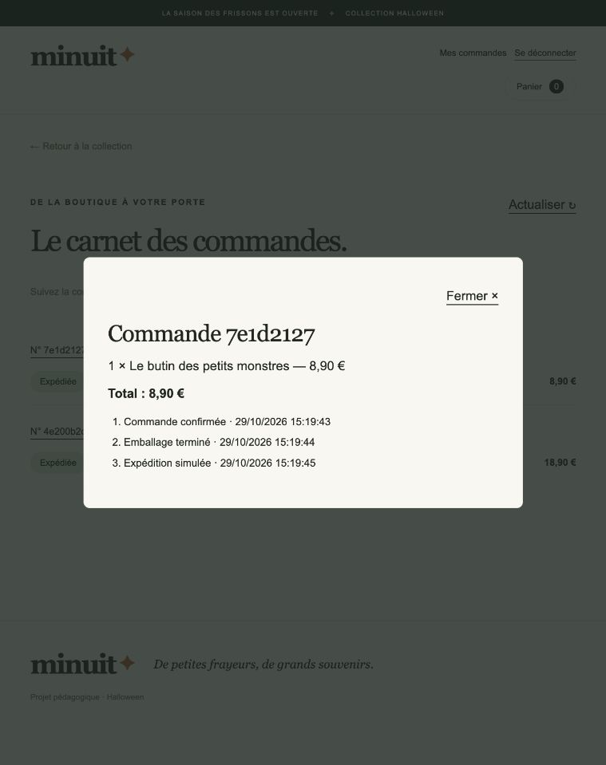
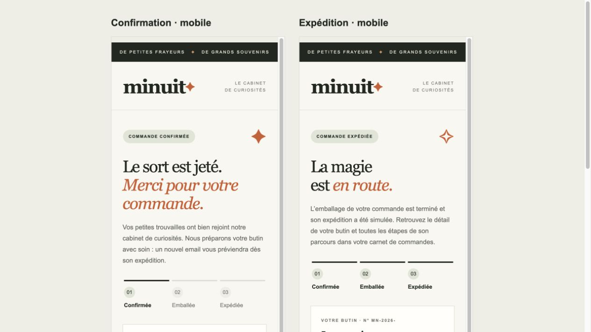

# Vérification des API du site AWS

Tests réalisés le 29 octobre 2026 sur https://d16osreerzkx1z.cloudfront.net, via la distribution CloudFront publique. Résultat : **49 vérifications réussies**, **aucun blocage restant sur les scénarios exercés**. Les erreurs 401, 404, 409 et 422 attendues ont été vérifiées comme comportements corrects.

## Parcours navigateur

Le navigateur a chargé les fichiers et le catalogue, effectué la connexion par le formulaire Cognito, ajouté un produit au panier et créé une commande. L’historique a affiché les deux commandes de test au statut Expédiée. Le détail contenait les trois événements attendus. La déconnexion a ramené à la boutique sans session.

La méthode de connexion hébergée a également été testée : redirection vers Cognito, saisie des identifiants temporaires, retour avec code, échange OAuth PKCE et consultation des commandes avec le jeton obtenu. Ces essais valident aussi les accès navigateur soumis à CSP et CORS pour les chemins exercés.

## Notifications : blocage levé

L’email de validation AWS a été renvoyé et l’identité expéditrice est maintenant **Success**. Les nouvelles tentatives automatiques ont réussi : les logs Lambda contiennent `event_processed consumer=notification` pour les deux commandes de test, à 14:28:06 et 14:28:44 UTC le 29 octobre 2026. Ces traces ne sont écrites qu’après acceptation de l’envoi SES et création du reçu SQL.

La file principale ne contient plus de messages visibles ou en cours de traitement ; la DLQ ne contient pas de messages. Aucun rejeu manuel n’a été nécessaire. Le compte reste en sandbox SES : les destinataires hors simulateur doivent être vérifiés. Les essais confirment l’acceptation par SES vers le simulateur, pas la réception dans une boîte réelle.

Les destinataires des commandes sont des adresses du simulateur SES AWS, sans boîte personnelle. [Simulateur officiel SES](https://docs.aws.amazon.com/ses/latest/dg/send-an-email-from-console.html).

## Périmètre et nettoyage

- Les trois comptes Cognito temporaires ont été supprimés ; les mots de passe et jetons temporaires locaux ont été effacés.
- Deux commandes de démonstration restent dans RDS avec leurs événements. Le stock de `citrouille` et `bonbons` a été diminué d’une unité chacun.
- Les comptes du parcours ont été créés et validés administrativement. L’API publique SignUp et le renvoi de code ont répondu 200 ; un code erroné a été rejeté par ConfirmSignUp. La confirmation avec un code effectivement reçu par email n’a pas été testée.
- Les tests locaux complémentaires comptent 34 tests Python réussis et 31 ignorés (PostgreSQL local non configuré et scénarios non applicables à SQLite), plus 3 tests JavaScript réussis. Les tests distants ont bien utilisé RDS.
- Ces tests ne mesurent pas la charge, la haute disponibilité ou la restauration.

## Résultats HTTP détaillés

| Vérification | Résultat | Observation |
| --- | --- | --- |
| Santé SQL | Réussi | GET /api/health: HTTP 200, attendu 200 |
| Base disponible | Réussi |  |
| Catalogue public | Réussi | GET /api/products: HTTP 200, attendu 200 |
| Catalogue complet | Réussi |  |
| Cache API désactivé | Réussi |  |
| Schéma OpenAPI | Réussi | GET /api/openapi.json: HTTP 200, attendu 200 |
| Ressource / | Réussi | HTTP 200 |
| Ressource /account.html | Réussi | HTTP 200 |
| Ressource /orders.html | Réussi | HTTP 200 |
| Ressource /config.js | Réussi | HTTP 200 |
| Ressource /app.js | Réussi | HTTP 200 |
| Ressource /auth.js | Réussi | HTTP 200 |
| Ressource /account.js | Réussi | HTTP 200 |
| Accès anonyme refusé /api/me | Réussi | GET /api/me: HTTP 401, attendu 401 |
| Accès anonyme refusé /api/orders | Réussi | GET /api/orders: HTTP 401, attendu 401 |
| Accès anonyme refusé /api/orders/not-an-order | Réussi | GET /api/orders/not-an-order: HTTP 401, attendu 401 |
| Commande anonyme refusée | Réussi | POST /api/orders: HTTP 401, attendu 401 |
| Jeton invalide refusé | Réussi | GET /api/me: HTTP 401, attendu 401 |
| Connexion Cognito client 1 | Réussi | HTTP 200 |
| Profil connecté client 1 | Réussi | GET /api/me: HTTP 200, attendu 200 |
| Connexion Cognito client 2 | Réussi | HTTP 200 |
| Profil connecté client 2 | Réussi | GET /api/me: HTTP 200, attendu 200 |
| Historique initial | Réussi | GET /api/orders?limit=20: HTTP 200, attendu 200 |
| Clé obligatoire | Réussi | POST /api/orders: HTTP 422, attendu 422 |
| Panier vide refusé | Réussi | POST /api/orders: HTTP 422, attendu 422 |
| Quantité invalide refusée | Réussi | POST /api/orders: HTTP 422, attendu 422 |
| Prix forgé refusé | Réussi | POST /api/orders: HTTP 422, attendu 422 |
| Pagination invalide refusée | Réussi | GET /api/orders?limit=101: HTTP 422, attendu 422 |
| Produit absent refusé | Réussi | POST /api/orders: HTTP 404, attendu 404 |
| Création commande | Réussi | POST /api/orders: HTTP 201, attendu 201 |
| Montant calculé serveur | Réussi |  |
| Rejeu même panier | Réussi | POST /api/orders: HTTP 201, attendu 201 |
| Aucun doublon | Réussi |  |
| Conflit clé autre panier | Réussi | POST /api/orders: HTTP 409, attendu 409 |
| Stock après commande | Réussi | GET /api/products: HTTP 200, attendu 200 |
| Stock décrémenté une seule fois | Réussi |  |
| Historique client | Réussi | GET /api/orders?limit=20: HTTP 200, attendu 200 |
| Commande dans historique | Réussi |  |
| Détail commande | Réussi | GET /api/orders/4e200b2d-6eb9-4a0a-aca0-42e1d197426f: HTTP 200, attendu 200 |
| Commande étrangère masquée | Réussi | GET /api/orders/4e200b2d-6eb9-4a0a-aca0-42e1d197426f: HTTP 404, attendu 404 |
| Historique autre client | Réussi | GET /api/orders: HTTP 200, attendu 200 |
| Isolation entre clients | Réussi |  |
| Chaîne asynchrone jusqu’à SHIPPED | Réussi | SHIPPED |
| Historique des trois événements | Réussi | CommandeCreee, EmballageTermine, ExpeditionTerminee |
| Cognito SignUp | Réussi | HTTP 200; OK |
| Cognito ResendConfirmationCode | Réussi | HTTP 200; OK |
| Cognito ConfirmSignUp | Réussi | HTTP 400; CodeMismatchException |
| Notification SES | Réussi | Expéditeur confirmé ; deux traitements de notification réussis après nouvelles tentatives automatiques ; file et DLQ vides. |
| Jeton révoqué refusé | Réussi | HTTP 401 après AdminUserGlobalSignOut |

## Extension : emails de confirmation et d’expédition

La Lambda de notification reçoit maintenant `CommandeCreee` et `ExpeditionTerminee` via son filtre SNS. Elle envoie au client de la commande un sujet et un contenu distincts pour chaque événement. Les reçus sont conservés séparément et les tests couvrent les doublons, les échecs réessayables et les événements reçus dans un ordre différent.

Vérification réelle du 2026-10-29T14:39:21Z : commande `f830c9c5-f817-4ab3-9e9f-5240e1f78840`, statut `SHIPPED`, deux événements de notification distincts traités avec succès après acceptation SES. Le destinataire était le simulateur AWS ; la réception dans une boîte réelle n’a pas été mesurée. Le compte temporaire a été supprimé. Cette commande reste enregistrée et a consommé une unité de `bonbons`.

Validation du changement : 45 tests Python réussis, 37 ignorés selon le moteur ou faute de PostgreSQL local ; 3 tests JavaScript réussis ; test Terraform `notifications.tftest.hcl` réussi. [Preuves des deux notifications](test-deux-emails.json).

## Vérification de réception dans une boîte réelle

Le 29 octobre 2026 à 14:55:13 et 14:55:16 UTC, les emails de confirmation et d’expédition d’une commande réelle ont été retrouvés dans INBOX via le connecteur Gmail. Le blocage initial cumulait une adresse destinataire non vérifiée en sandbox et une permission IAM SES trop étroite pour ce chemin d’envoi. La validation du destinataire puis l’ajustement IAM, en conservant l’expéditeur strict, ont permis le traitement des deux événements d’origine sans recréer la commande.

Les nouveaux tests réussis couvrent le code d’erreur AWS sans données personnelles dans les logs (13 tests d’événements réussis, 15 ignorés) et les restrictions IAM (2 scénarios Terraform de notification réussis). Les limites de réception réelle mentionnées plus haut concernent uniquement les essais initiaux vers le simulateur.

## Mise en page HTML Minuit

Les deux variantes HTML et leurs alternatives texte ont été déployées. La commande `5bd1054a-db17-4b68-a278-92853e252e1c` du 2026-10-29T15:09:23Z est passée à SHIPPED et a produit deux notifications acceptées par SES vers le simulateur AWS. Le compte temporaire a été supprimé. Le modèle HTML est inclus dans l’archive Lambda et le lien SITE_URL déployé correspond à CloudFront. Le rendu a été inspecté dans un navigateur en bureau et sur une largeur mobile de 375 pixels, y compris les lignes de commande, les totaux et le bouton. 56 tests Python et les deux scénarios Terraform de notification passent ; les tests PostgreSQL locaux restent ignorés sans base configurée.

